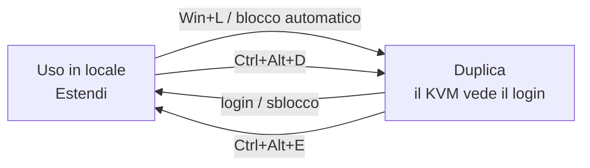

# kvm-display-switch

[](https://github.com/OWNER/kvm-display-switch/actions/workflows/ci.yml)


**SchermiKVM** (`schermi-kvm.ps1`) passa automaticamente gli schermi di Windows in **Duplica** quando blocchi il PC e in **Estendi** quando rientri, così un KVM-over-IP collegato come secondo display (es. **GL.iNet Comet**) mostra sempre la schermata di login, senza toccare la risoluzione nativa del monitor principale.

> **In short (EN):** a single PowerShell script that switches Windows to *Duplicate* on lock and back to *Extend* on logon/unlock, so a KVM-over-IP plugged in as a second display always shows the login screen. Self-installing, logs every switch, includes hotkeys.

---

## Il problema

Con un KVM in passthrough tra PC e monitor, il PC legge l'EDID del KVM e non quello del monitor. Su un super-ultrawide 32:9 (5120×1440) l'immagine 16:9 del KVM viene stirata su tutto il pannello.

La soluzione è collegare il monitor direttamente al PC (es. USB-C/DisplayPort) e il KVM a un'altra uscita (HDMI) come **secondo schermo**. Così però, in modalità Estendi, il KVM mostra un desktop vuoto e la schermata di login finisce solo sul monitor principale. SchermiKVM risolve proprio questo.

## Come funziona



- Il cambio usa **`SetDisplayConfig`**, la stessa API di Windows che usa Win+P. `DisplaySwitch.exe` resta come riserva, perché sulle build recenti di Windows 11 ignora spesso gli argomenti.
- Dopo ogni cambio lo script **verifica** il numero di schermi attivi e riprova fino a 3 volte con metodi diversi.
- Ogni operazione viene **registrata** in `%LOCALAPPDATA%\SchermiKVM\schermi-kvm.log`.

## Requisiti

- Windows 10 o 11
- Windows PowerShell 5.1 (già incluso) o PowerShell 7
- Privilegi di amministratore **solo** per installare o disinstallare

## Installazione

1. Scarica `schermi-kvm.ps1` (oppure clona il repository).
2. Apri PowerShell nella cartella del file ed esegui:

   ```powershell
   Unblock-File .\schermi-kvm.ps1
   powershell -ExecutionPolicy Bypass -File .\schermi-kvm.ps1
   ```

3. Nel menu scegli **1 - Installa / aggiorna** e accetta il prompt di amministratore.

L'installazione:

| Elemento | Dettaglio |
|---|---|
| Script | copiato in `C:\ProgramData\SchermiKVM\schermi-kvm.ps1` |
| Attività pianificata | `SchermiKVM - Duplica al blocco` (trigger: blocco sessione) |
| Attività pianificata | `SchermiKVM - Estendi al login` (trigger: sblocco +3 s, login +5 s) |
| Icona desktop | **Blocca (duplica)**: Duplica e poi blocca il PC |
| Icona desktop | **Esci (duplica)**: Duplica e poi disconnette l'utente |
| Icona desktop | **Duplica schermi**, scorciatoia `Ctrl+Alt+D` |
| Icona desktop | **Estendi schermi**, scorciatoia `Ctrl+Alt+E` |

Le attività girano con l'utente corrente e **senza privilegi elevati**. Per aggiornare a una nuova versione basta rilanciare l'installazione: sovrascrive tutto.

## Uso

### Menu interattivo

```text
SchermiKVM 1.2.0 - Duplica/Estendi automatico per KVM
Modalita' attuale: Estendi (2 schermi)

  1  Installa / aggiorna
  2  Stato e log
  3  Test (Duplica -> Estendi)
  4  Disinstalla
  0  Esci
```

### Riga di comando

```powershell
powershell -ExecutionPolicy Bypass -File .\schermi-kvm.ps1 -Azione <Azione>
```

| Azione | Effetto | Admin |
|---|---|:---:|
| `Menu` | Menu interattivo (predefinito) | |
| `Installa` | Installa o aggiorna | ✔ |
| `Disinstalla` | Rimuove attività, icone e file | ✔ |
| `Stato` | Stato, attività pianificate, ultime righe del log | |
| `Test` | Prova Duplica → Estendi | |
| `Duplica` | Passa in Duplica | |
| `Estendi` | Passa in Estendi | |
| `Blocca` | Duplica e poi blocca il PC | |
| `Esci` | Duplica e poi disconnette l'utente | |

L'help completo è disponibile con:

```powershell
Get-Help .\schermi-kvm.ps1 -Full
```

### Accesso remoto tramite KVM

Se fai il login **da remoto**, scatta comunque Estendi e la console del KVM mostra il desktop vuoto. Premi **Ctrl+Alt+D** dalla tastiera della console per passare in Duplica. Quando torni alla postazione, premi **Ctrl+Alt+E**.

## Disinstallazione

Dal menu scegli **4 - Disinstalla**, oppure:

```powershell
powershell -ExecutionPolicy Bypass -File .\schermi-kvm.ps1 -Azione Disinstalla
```

Rimuove attività, icone e `C:\ProgramData\SchermiKVM`, chiede se cancellare anche il log e riporta gli schermi in Estendi.

## Risoluzione dei problemi

| Sintomo | Causa / soluzione |
|---|---|
| `Il file ... non è firmato digitalmente` | Il file scaricato ha il marchio "da internet". Esegui `Unblock-File .\schermi-kvm.ps1` e avvialo con `-ExecutionPolicy Bypass`. |
| `Get-ExecutionPolicy -List` mostra un valore in `MachinePolicy` o `UserPolicy` | Il criterio è imposto da Criteri di gruppo e `-ExecutionPolicy Bypass` viene ignorato. Serve firmare lo script o chiedere un'eccezione all'amministratore. |
| `LastTaskResult : 267011` | L'attività non è ancora mai stata eseguita: è normale subito dopo l'installazione. |
| Nel log compare `non applicata dopo 3 tentativi` | Controlla il `codice` riportato da `SetDisplayConfig`. Verifica che entrambi gli schermi siano collegati e che Win+P funzioni manualmente. |
| Al blocco il KVM resta nero | Alcune configurazioni ignorano i cambi a sessione già bloccata. Usa l'icona **Blocca (duplica)**, che passa in Duplica *prima* di bloccare. |
| `Ctrl+Alt+D` / `Ctrl+Alt+E` non rispondono | Windows registra le scorciatoie delle icone al login: disconnettiti e rientra una volta. |
| Breve lampo di una finestra al blocco/sblocco | È PowerShell avviato nascosto dall'attività pianificata: comportamento atteso. |

Per una diagnosi rapida:

```powershell
Get-ScheduledTask -TaskName 'SchermiKVM*' | Get-ScheduledTaskInfo |
    Format-List TaskName, LastRunTime, LastTaskResult
Get-Content "$env:LOCALAPPDATA\SchermiKVM\schermi-kvm.log" -Tail 20
```

## Cosa modifica sul sistema

Per trasparenza, l'elenco completo:

- `C:\ProgramData\SchermiKVM\` (copia dello script)
- `%LOCALAPPDATA%\SchermiKVM\` (log, ruotato oltre 512 KB)
- 2 attività pianificate con prefisso `SchermiKVM - `
- 4 collegamenti sul desktop

Lo script **non** modifica il registro, i criteri di esecuzione, i driver o altre impostazioni di sistema. Non effettua connessioni di rete.

## Sviluppo

```text
.
├── schermi-kvm.ps1                  # lo script (unico file distribuito)
├── tests/
│   └── schermi-kvm.Tests.ps1        # test Pester 5 (analisi statica, non eseguono lo script)
├── PSScriptAnalyzerSettings.psd1    # regole di lint
└── .github/workflows/ci.yml         # lint + test su windows-latest
```

Eseguire lint e test in locale:

```powershell
Install-Module PSScriptAnalyzer, Pester -Scope CurrentUser -Force
Invoke-ScriptAnalyzer -Path . -Recurse -Settings .\PSScriptAnalyzerSettings.psd1
Invoke-Pester -Path .\tests -Output Detailed
```

Convenzioni:

- Solo caratteri **ASCII** nello script, così Windows PowerShell 5.1 lo legge correttamente senza BOM.
- Fine riga **CRLF** per i `.ps1` (vedi `.gitattributes`).
- Le funzioni usano nomi italiani (`Imposta-Modalita`, `Esegui-Installa`...): la regola `PSUseApprovedVerbs` è disattivata di proposito.

## Licenza

[MIT](LICENSE)
